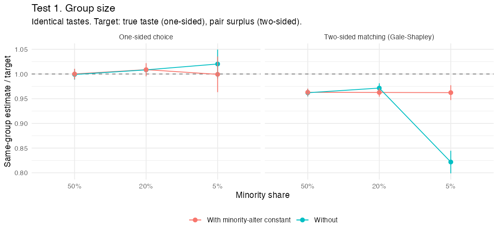
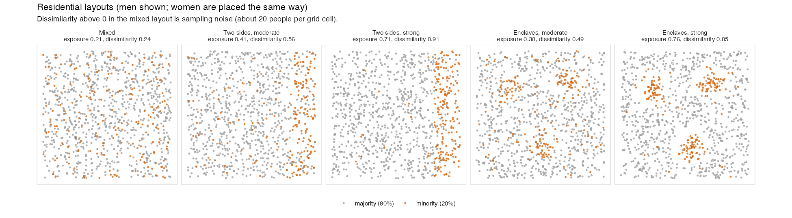
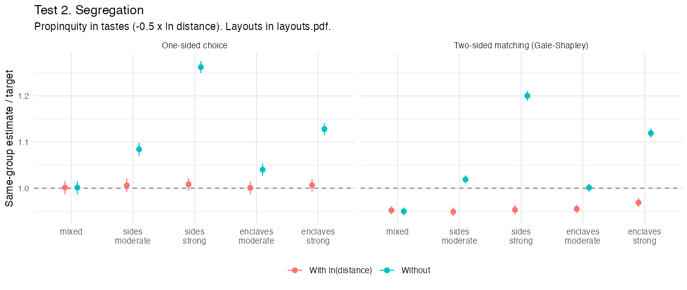
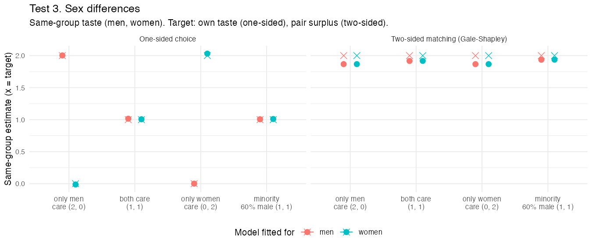
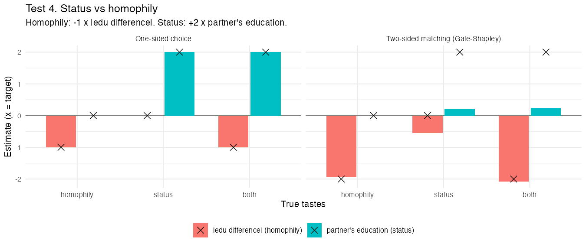

# A. Recovery: does a well-specified model estimate what it should?

**In short:**
- **What it gets right.** A conditional logit with alter-group constants
  recovers same-group assortativity regardless of group size, and
  regardless of residential segregation as long as distance is in the
  model.
- **The scale.** Under one-sided choice it recovers individual tastes.
  Under two-sided matching it recovers the pair-level assortativity, at a
  stable scale of about 0.96.
- **What it cannot tell.** It cannot say which sex holds a taste, and it
  cannot see status preferences. The sorting that status competition
  produces is read as homophily.

## Design

- **Market:** 1,000 men and 1,000 women; a majority and a minority group
  (minority 20% unless varied); education ~ N(0, 1).
- **Tastes:** +1 x same group - 1 x |education difference| unless varied.
- **Two ways of forming unions:**
  - one-sided choice: each person picks freely; this is what the logit
    assumes;
  - Gale-Shapley: both must agree; 85% pair up.
- **Estimation:**
  - 100 alternatives per partnered man, drawn at random from the other sex;
  - egos from both groups pooled;
  - the well-specified model is same group + minority-alter constant +
    |education difference|.
- **Target:**
  - one-sided: the true taste;
  - two-sided: the pair surplus, the sum of both partners' tastes.
- 200 simulated markets per cell. All 28 checks pass (`results/checks.csv`).

## Test 1. Group size

| Minority share | One-sided | Two-sided | Two-sided, no constant |
|---|---|---|---|
| 50% | 1.00 | 0.96 | 0.96 |
| 20% | 1.01 | 0.96 | 0.97 |
| 5% | 1.00 | 0.96 | **0.82** |

Same-group estimate / target.

- With the minority-alter constant, group size does not matter.
- Without it, a small minority looks less assortative than it is under
  two-sided matching.
- **Why:** every mixed couple is an out-marriage for one person in each
  group. That is a small share of a large group's unions and a large share
  of a small group's. The constant absorbs how attainable each group is as
  partners.

## Test 2. Segregation

- **Tastes add propinquity:** -0.5 x ln(distance).
- **Layouts** (`plot_layouts.R`; measures in `results/layouts.csv`):
  - **two sides:** each group mostly on its own side;
  - **enclaves:** the minority mostly in three small clusters;
  - each at a moderate and a strong level.

| Layout | One-sided, with distance | One-sided, without | Two-sided, with distance | Two-sided, without |
|---|---|---|---|---|
| mixed | 1.00 | 1.00 | 0.95 | 0.95 |
| sides, moderate | 1.01 | 1.08 | 0.95 | 1.02 |
| sides, strong | 1.01 | **1.26** | 0.95 | **1.20** |
| enclaves, moderate | 1.00 | 1.04 | 0.96 | 1.00 |
| enclaves, strong | 1.01 | **1.13** | 0.97 | **1.12** |

Same-group estimate / target.

- With ln(distance) in the model, segregation does not affect the
  same-group estimate. The distance term is recovered too: 0.99 to 1.00
  one-sided, 0.92 to 0.93 two-sided.
- Without it, propinquity is read as endogamy: up to 26% too high.

## Test 3. Sex differences

| Same-group taste (men, women) | One-sided: men / women | Two-sided: men / women |
|---|---|---|
| only men care (2, 0) | 2.00 / -0.01 | 1.87 / 1.87 |
| only women care (0, 2) | 0.00 / 2.03 | 1.87 / 1.87 |
| both care (1, 1) | 1.01 / 1.01 | 1.92 / 1.92 |
| equal tastes, minority 60% male | 1.01 / 1.01 | 1.94 / 1.94 |

- One-sided choice recovers each sex's taste.
- Under two-sided matching, the models for men and for women give the same
  number in every world. They estimate the pair, so who holds the taste is
  not identified.
- An unbalanced sex ratio does not create a spurious sex gap when the
  minority-alter constant is in the model.

## Test 4. Status vs homophily

| Tastes (homophily, status) | One-sided: homophily term / status term | Two-sided: homophily term / status term |
|---|---|---|
| homophily (-1, 0) | -1.00 / 0.00 | -1.93 / 0.00 |
| status (0, +2) | -0.01 / 2.01 | **-0.55 / 0.22** |
| both (-1, +2) | -1.00 / 2.01 | -2.07 / **0.24** |

- **Homophily** is the |education difference| term; **status** is the
  partner's education.
- One-sided choice separates the two.
- Under two-sided matching a status taste of 2 shows up as about 0.2.
- Status competition still sorts couples by education (correlation 0.35),
  and the model reads that sorting as homophily: -0.55 where the truth is
  0.
- With both tastes present, homophily is recovered and status nearly
  disappears.
- **Why:** in a two-sided market, terms that describe only the partner
  (the partner's education, the alter-group constant) measure who is
  attainable, not what the chooser wants.

## Files

| File | Contents |
|---|---|
| `run.R` | Runs all four tests (about 15 minutes on 10 cores) |
| `analyse.R` | Writes `results/summary.csv`, `results/checks.csv` and the four figures |
| `plot_layouts.R` | Draws the residential layouts and measures segregation |
