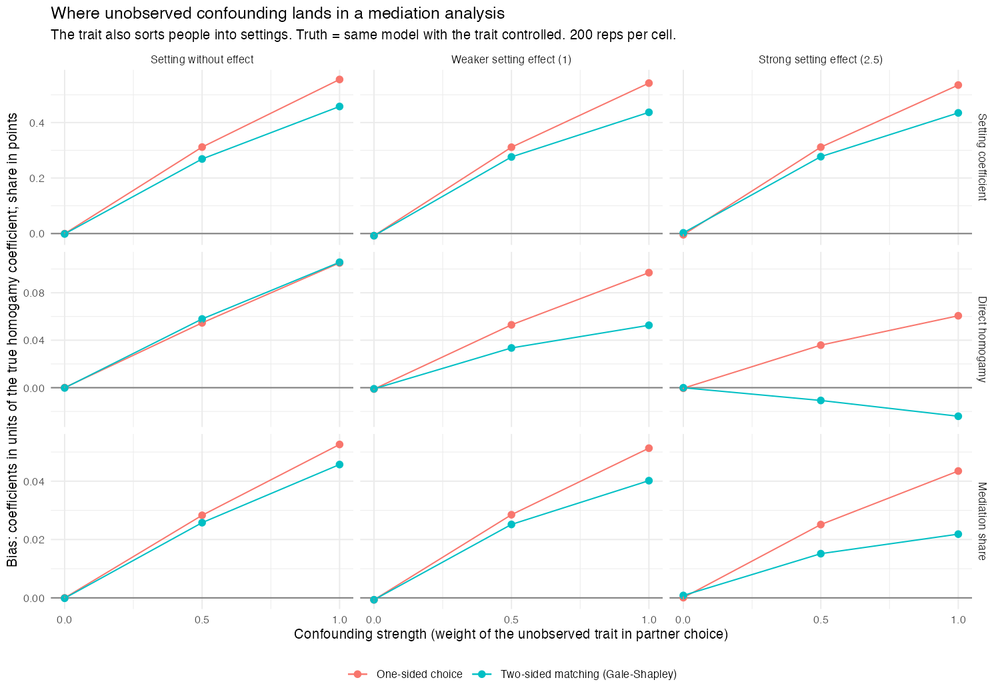

# B. Mediation: where does unobserved confounding land?

**In short:**
- When an unobserved trait drives both who ends up in a setting (a
  workplace, say) and whom people choose, the bias lands mainly on the
  **setting coefficient**. A setting with no effect at all gets a sizeable
  positive coefficient.
- The **direct homogamy** coefficient moves by at most about 10%.
- The **mediation share** is inflated by 2 to 5 points. That is a large
  error when the setting's real role is small, a modest one when it is
  large.
- Two-sided matching does not change where the bias lands.

## Design

- **Market:** 1,000 men and 1,000 women; education ~ N(0, 1).
- **Settings:** 10 settings that people join partly by education and
  partly by an unobserved trait t ~ N(0, 1).
- **Tastes:** -1 x |education difference| + b x same setting - gamma x
  |t difference|.
  - b: the setting's real effect: 0 (none), 1 (weaker), 2.5 (strong).
  - gamma: confounding strength: 0, 0.5, 1.
- **Unions:** one-sided choice or Gale-Shapley (85% pair up).
- **Researcher's model:** KHB decomposition of the education coefficient,
  with and without same setting (Karlson, Holm and Breen 2012).
- **Truth:** the same decomposition with |t difference| added. Only a
  simulation can fit it. Both are fitted to the same markets.
- 200 markets per cell, men as egos, 100 alternatives each.

## Results

One-sided choice; researcher's estimate / truth:

| Setting effect | Confounding | Setting coefficient | Direct homogamy | Mediation share |
|---|---|---|---|---|
| none (0) | 0.5 | 0.31 / 0.00 | -0.95 / -1.00 | 0.028 / 0.000 |
| none (0) | 1 | **0.56 / 0.00** | -0.89 / -1.00 | **0.053 / 0.000** |
| weaker (1) | 0.5 | 1.32 / 1.00 | -0.95 / -1.01 | 0.111 / 0.082 |
| weaker (1) | 1 | **1.54 / 0.99** | -0.91 / -1.01 | **0.133 / 0.081** |
| strong (2.5) | 0.5 | 2.81 / 2.50 | -0.97 / -1.00 | 0.212 / 0.187 |
| strong (2.5) | 1 | **3.03 / 2.50** | -0.94 / -1.00 | **0.232 / 0.189** |

**Setting coefficient.**
- Biased up by about 0.3 (moderate confounding) and 0.55 (strong), whatever
  the setting's real effect.
- In units of the homogamy coefficient, the bias is similar under
  two-sided matching: 0.27 and 0.44 to 0.46.

**Direct homogamy.**
- Shrinks by 4 to 11% toward zero under one-sided choice.
- Under two-sided matching with a strong setting the error is small and
  goes the other way: up to 2%.

**Mediation share.**
- Inflated by 0.02 to 0.05.
- With no real effect, the setting is credited with 3 to 5% of homogamy.
- With a weaker setting, 0.13 instead of 0.08 (about 60% too high).
- With a strong setting, 0.23 instead of 0.19 (about 20% too high).

With no confounding (gamma = 0), researcher and truth agree within 0.01 on
every quantity.

## Files

| File | Contents |
|---|---|
| `run.R` | Runs the 18 cells (about 12 minutes on 10 cores) |
| `analyse.R` | Writes `results/summary.csv` and the figure |
