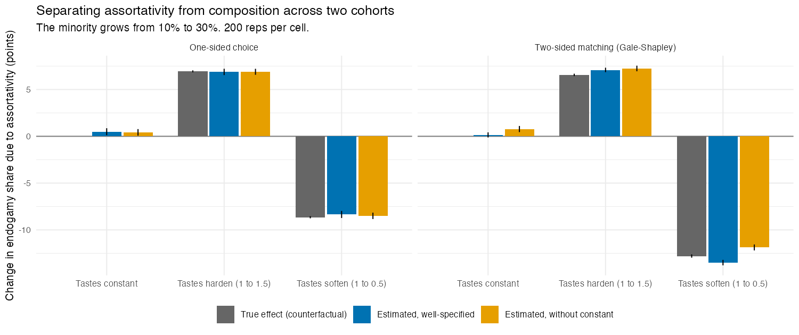

# C. Change over time: assortativity or composition?

**In short:** when the minority grows between two cohorts, a
composition/coefficient decomposition built on the well-specified model
separates the two:
- the part attributed to assortativity is about zero when tastes are
  constant;
- it tracks real hardening or softening, with the right sign and close to
  the right size;
- the minority-alter constant absorbs the two-sided market's own adjustment
  to the new composition.

## Design

- **Two cohorts.** Each is its own market of 1,000 men and 1,000 women, as
  in study A. The minority grows from 10% to 30%.
- **Same-group taste:** constant (1 to 1), hardening (1 to 1.5) or softening
  (1 to 0.5); education -1 throughout.
- **Unions:** one-sided choice or Gale-Shapley (85% pair up).
- **Model:** same group + minority-alter constant + |education difference|,
  fitted per cohort. The same model without the constant is shown for
  comparison.
- **Outcome:** the share of men's unions within their own group.
- **Decomposition:**
  - composition = cohort 2's choice sets with cohort 1's coefficients,
    minus cohort 1;
  - the remaining change is split by term (Shapley), giving a same-group
    part (assortativity) and a constant part (attainability).
- **Truth:** cohort 2's people rematched with cohort 1's tastes, using the
  same random draws.
- 200 replications per cell. All 8 checks pass (`results/checks.csv`).

## Results

Changes in the endogamy share, in percentage points (Monte Carlo SEs 0.1
to 0.3):

| Tastes | Unions | Observed change | Composition | Same-group part | True effect | Constant part |
|---|---|---|---|---|---|---|
| constant | one-sided | -12.0 | -12.5 | **+0.5** | 0 | 0.0 |
| constant | two-sided | -5.0 | -6.3 | **+0.2** | 0 | +1.1 |
| harden | one-sided | -5.2 | -12.1 | +6.9 | +6.9 | 0.0 |
| harden | two-sided | +1.7 | -6.1 | +7.1 | +6.6 | +0.7 |
| soften | one-sided | -20.7 | -12.4 | -8.4 | -8.7 | 0.0 |
| soften | two-sided | -17.8 | -6.3 | -13.5 | -12.8 | +2.0 |

- **Composition.** A growing minority lowers endogamy by about 12 points in
  a one-sided market, but only about 5 in a two-sided one, where majority
  members still largely find each other. The composition part plus the
  constant's part reproduces the two-sided market's actual change.
- **Assortativity.**
  - The same-group part is near zero when tastes are constant.
  - It has the right sign in at least 99.5% of replications when they
    change.
  - It is within 8% of the true size.
  - The same-group coefficient itself moves by 0.01 under two-sided
    matching when tastes are constant.
- **Without the constant**, constant tastes under two-sided matching show a
  spurious +0.8 points (the coefficient rises by 0.07). The effect grows
  as the minority gets smaller (study A, test 1).

## Files

| File | Contents |
|---|---|
| `run.R` | Runs the six cells (about 9 minutes on 10 cores) |
| `analyse.R` | Writes `results/summary.csv`, `results/checks.csv` and the figure |
